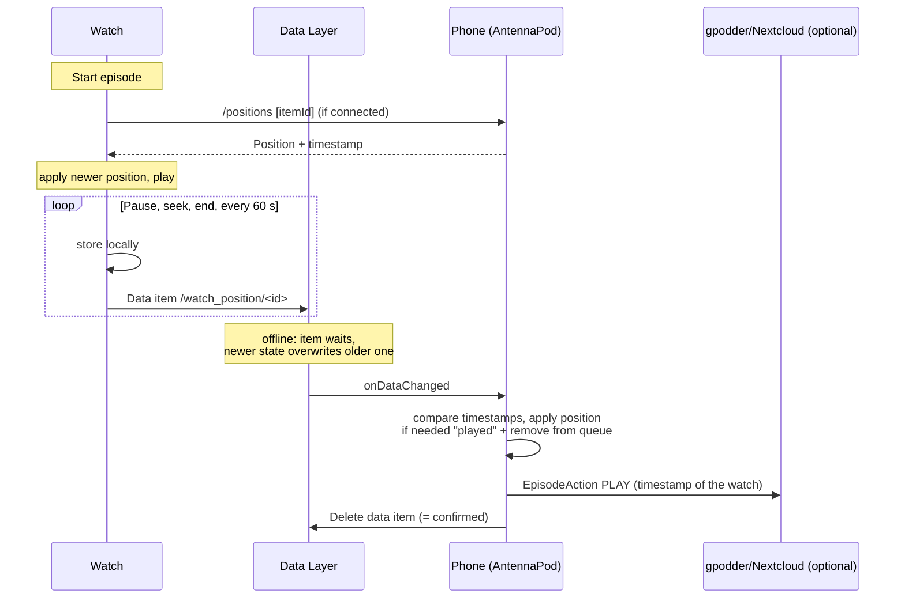

# Concept: Playback on the Watch for AntennaPod (Wear OS)

As of: 2026-10-02 · Based on: AntennaPod `develop` @ `0ad82a8` (3.12.1)

## 1. Goal

The existing watch app (`app-wearos`) is currently a remote control for the phone. In addition, it should:

1. **download episodes** from AntennaPod **to the watch**,
2. **play them on the watch** (play/pause, −20 s, +30 s, next episode),
3. allow a **separate order** on the watch,
4. **reliably synchronize the playback progress with the phone** (most important point).

Principle: **The phone stays in charge.** Subscriptions, episodes and the queue are only managed there. The watch only holds a selection of episodes and reports its progress back.

## 2. Current State of the Code

| Part | File | What it does today |
|---|---|---|
| Interface | `net/sync/wear-interface` (`WearDataPaths`, `WearSerializer`) | Message paths and JSON format. Episodes only contain ID, title, date, duration and position. |
| Phone | `app/src/play/.../WearListenerService.java` | Answers requests from the watch (lists, play, pause, skip) and sends `NOW_PLAYING` on status changes. |
| Watch | `app-wearos/.../sync/*` | `WearMessageSender` sends messages, `WearDataListenerService` receives replies, `WearDataRepository` keeps them in memory. |
| Version | `wear_capability_phone = antennapod_phone_v1` | Capability the watch uses to find a matching phone. |

Important properties of the current solution:

- Only the **`MessageClient`** is used. Messages are lost if the watch is not connected at that moment. That is fine for lists, but not for positions.
- The watch stores **nothing permanently**. Everything is only kept in memory.
- The phone ignores unknown paths ("Ignoring unknown path"). New paths are therefore harmless for old phone versions.

Building blocks in the phone code that can be reused:

- `PlayableUtils.saveCurrentPosition(media, position, timestamp)`: sets position, time of last playback and played duration and saves everything.
- `Media3PlaybackService.updateDatabaseAfterPlayback(...)`: logic for "episode finished" (mark as played, remove from queue, auto-delete, history). The method is `private` today and would have to be extracted for this.
- `SynchronizationQueue.enqueueEpisodeAction(...)`: passes positions on to the gpodder synchronization. `EpisodeAction.Builder.timestamp(Date)` allows a custom timestamp.
- `DBReader.getFeedItemByGuidOrEpisodeUrl(guid, url)`: finds an episode even without the database ID.

## 3. Basic Decisions

| # | Question | Proposal | Reason |
|---|---|---|---|
| D1 | Which episodes go onto the watch? | **Select manually on the watch** from the existing lists (queue, downloads, subscriptions). Later optionally automatic: "the first N of the queue". | Simple, and the phone remains the source. |
| D2 | How does the file get onto the watch? | **The watch downloads it itself over Wi-Fi** from the original URL of the episode. The phone only provides the URL. | Much faster than Bluetooth, and the episode does not have to be downloaded on the phone. For an alternative see 5.2. |
| D3 | Does the order on the watch change the queue on the phone? | **No.** The watch has its **own list** ("On watch") with its own order. | No conflicts with the queue on the phone, and the phone stays in charge. |
| D4 | Who wins if the positions differ? | **The most recent timestamp.** | This is how AntennaPod handles the gpodder synchronization, too (`EpisodeActionFilter`). |
| D5 | How are positions transferred from the watch? | Using the **`DataClient`** (data items), not messages. | Data items are stored and delivered as soon as there is a connection again, even after a restart. |
| D6 | How is an episode identified? | **Database ID from the phone**, plus **GUID and download URL** as a fallback. | The ID is unique. GUID and URL help if the database was re-imported. |
| D7 | What happens after an episode ends on the watch? | The phone marks it as played. The watch **deletes its file** and continues with the next episode of the list. | Saves storage and behaves like the phone. |

## 4. Extending the Interface (`wear-interface`)

Things are **only added**, nothing existing is changed.

### 4.1 Version Capability

The phone additionally advertises the capability `antennapod_phone_standalone_v1`. The watch only shows the new features if a phone with this capability is connected. Older phone versions keep working as a pure remote control.

### 4.2 New Messages (`MessageClient`, Request and Reply)

| Path | Direction | Content of the reply |
|---|---|---|
| `/episode_details/<itemId>` | Watch → phone | Download URL, file type, size, GUID, name of the podcast, current position and timestamp, whether played |
| `/positions` (payload: list of IDs) | Watch → phone | For each ID that still exists: position, timestamp of last playback, played yes/no. Deleted episodes are missing from the reply. |
| `/settings` | Watch → phone | Skip amount back/forward (`getRewindSecs` / `getFastForwardSecs`), threshold for "almost finished" (`getSmartMarkAsPlayedSecs`), playback speed |

The skip amounts therefore come from the phone settings. For −20 s / +30 s you set them once on the phone.

### 4.3 New Data Items (`DataClient`)

| Path | Written by | Content |
|---|---|---|
| `/watch_position/<itemId>` | Watch | `itemId`, `guid`, `episodeUrl`, `position` (ms), `duration` (ms), `startPosition` (ms), `timestamp` (time on the watch), `completed` |

- There is **one** data item per episode. A newer state overwrites the older one. If the watch was offline for a long time, only the last state arrives.
- The phone processes the item and **deletes it afterwards**. This confirms that it arrived.
- For the opposite direction (phone → watch), a request via `/positions` is enough when the watch is connected again or wants to start an episode. A data item is not needed for that.

### 4.4 Format

As before, JSON via `org.json` in `WearSerializer`. New fields are read with `opt...` so that old and new versions stay compatible. Limit: messages and data items may be at most **100 KB**. That is enough for lists with about 100 episodes.

## 5. Watch (`app-wearos`)

### 5.1 Data on the Watch

- **"On watch" list:** episodes with `itemId`, title, podcast, duration, position, timestamp, file path, download status and sort position. Stored as a small JSON file in the app storage. With 10 to 30 episodes a database is not necessary, and no new dependency is added.
- **Files:** `filesDir/episodes/<itemId>.<extension>`.

### 5.2 Download

- `WorkManager` (`androidx.work:work-runtime` is already used in AntennaPod), so that downloads also run in the background and survive restarts. The worker runs in the foreground with a notification, so long downloads are not stopped after 10 minutes.
- **Explicitly request Wi-Fi** using `ConnectivityManager.requestNetwork` with `TRANSPORT_WIFI`. Otherwise Wear OS turns Wi-Fi off to save power, and the download is very slow over Bluetooth.
- Download using OkHttp (already used in AntennaPod), with progress display and cancellation. Interrupted downloads continue using HTTP range requests.
- Without Wi-Fi, the download waits and retries regularly. Only real download errors count as failed attempts.
- **Storage limit:** at most 1 GB for all episodes, and at least 100 MB of the storage of the watch stay free. Checked before the download and again with the real file size from the server.
- Not in V1: podcasts with username and password (`FeedPreferences.getUsername/getPassword`). These episodes are grayed out.
- **Possible later alternative:** the phone sends the already downloaded file using `ChannelClient.sendFile`. This works without Wi-Fi on the watch and also for podcasts with a password, but is considerably slower.

### 5.3 Playback

- Media3 ExoPlayer in a separate `MediaSessionService` on the watch (Media3 is already used in AntennaPod).
- **Headphones:** many watches do not play media through the speaker. With `ExoPlayer.Builder.setSuppressPlaybackOnUnsuitableOutput(true)`, playback waits for Bluetooth headphones, and Media3 can then open the selection of Bluetooth devices.
- **Running playback on the watch face:** ongoing activity (`androidx.wear:wear-ongoing`). This dependency would be new. Not implemented.
- **Buttons:** back (skip amount from the phone), play/pause, forward, next episode of the list. Volume using the rotating crown, if the watch has one.
- At the end of an episode: report the position as `completed`, delete the file, start the next episode. Skipping to the next episode within the "smart mark as played" time of the phone counts as the end of the episode.
- Settings from the phone (skip amounts, playback speed, smart mark as played) are stored on the watch and applied immediately, also during playback.

### 5.4 Reporting Positions

A `PositionReporter` writes `/watch_position/<itemId>`:

- on **pause**, **seek**, **episode change** and **end**,
- **every 60 seconds** during playback, so that little is lost on a crash or an empty battery.

The position is **always stored locally first** and then transferred to the phone.

### 5.5 User Interface

- Main list: new entry **"On watch"** next to the existing lists.
- Detail screen of an episode (from the phone): new button **"Download to watch"**.
- "On watch" list: tapping starts playback. A **long press** opens a menu with "Move up", "Move down", "Move to top" and "Remove". Drag & drop does not exist in Compose for Wear OS, and it would also be impractical on the round display.
- Player screen with the four buttons, progress as a ring at the edge.
- All new strings go into `ui/i18n/src/main/res/values/strings_wearos_standalone.xml`. A separate file avoids merge conflicts with `strings.xml` and the translations from Weblate. For a pull request to AntennaPod, they would move to `strings.xml`, as required by `AGENTS.md`.

## 6. Phone (`app`, Play Flavor Only)

- `WearListenerService`:
  - answers the new messages from 4.2,
  - additionally receives `onDataChanged` for `/watch_position/*`. For this, the intent filter `com.google.android.gms.wearable.DATA_CHANGED` is added to the manifest.
- **Applying a position from the watch** (new helper class, e.g. `WearPositionApplier`):
  1. Look up the episode by `itemId`, otherwise using `getFeedItemByGuidOrEpisodeUrl`. Unknown episode: delete the item and ignore it.
  2. If the timestamp of the watch is **older** than `lastPlayedTimeHistory` on the phone, ignore it (D4).
  3. Otherwise apply the position (like `PlayableUtils.saveCurrentPosition`, but with the timestamp of the watch).
  4. If `completed` is set or the episode is almost finished: the same logic as `updateDatabaseAfterPlayback`. This method would have to be extracted from `Media3PlaybackService`. This change should be discussed with the AntennaPod developers beforehand.
  5. **Pass it on to the gpodder synchronization**: `EpisodeAction` of type `PLAY` with the timestamp of the watch. This way the position also ends up in Nextcloud or on gpodder.net.
  6. Delete the data item.
- If the phone is **currently playing the same episode**, the phone wins automatically because it stores its position every few seconds with a newer timestamp. No special rule is needed for this.

## 7. Flow: Synchronizing Progress

## 8. Special Cases

| Case | Behavior |
|---|---|
| Watch without the phone for hours | Positions are kept as data items on the watch and are delivered on the next contact. |
| Same episode first on the watch, then continued on the phone | The phone has the newer timestamp. The watch fetches the position via `/positions` before the next start. |
| Episode marked as played or deleted on the phone | On the next `/positions`, the phone reports "played", or the episode is missing from the reply. The watch shows this and offers to delete the file. |
| Database re-imported on the phone (different IDs) | Fallback lookup using GUID or download URL. |
| Debug and release version mixed | Does not work because the package name or the signing key does not match. Both sides must be built the same way (`.debug`). |
| Time on watch and phone differs | Wear OS normally takes the time from the phone. Remaining risk: differences of a few seconds, not critical. |
| Multiple watches or phones | Not planned. The first connected device is used, as today. |
| No Wi-Fi nearby when downloading | The episode shows "Waiting for Wi-Fi". The download is retried with increasing intervals and never fails because of missing Wi-Fi. |
| Download stopped by the system | Not counted as an error. The download continues where it stopped on the next attempt. |
| Not enough space on the watch | The download fails immediately, without retries. |
| Settings changed on the phone | The watch receives them the next time the app is opened and applies them immediately, also to a running playback. |

## 9. Implementation in Steps

Each step works on its own and can later become a separate pull request to AntennaPod (option A).

| Step | Content | Result |
|---|---|---|
| 0 | Development environment: pair phone and Wear emulator, install both debug builds, import the database from the official AntennaPod | The existing remote control works. |
| 1 | Interface: capability `standalone_v1`, `/episode_details`, `/settings`, `/positions` | The watch knows download URLs and settings. |
| 2 | "On watch" list and download (WorkManager, Wi-Fi, storage limit) | Episodes are stored on the watch. |
| 3 | Playback on the watch (Media3 service, four buttons, headphone check) | The watch plays without the phone. |
| 4 | **Progress watch → phone** (data items, `WearPositionApplier`, gpodder) | **Core feature done.** |
| 5 | Progress phone → watch and cleaning up played episodes | Synchronization works in both directions. |
| 6 | Changing the order and "next episode" | All features from the goal are implemented. |
| 7 | Polish: ongoing activity, error messages, tests | Ready for everyday use. |

## 10. Test Cases for the Synchronization

1. Listen on the watch, pause, open on the phone: the position is correct (deviation of a few seconds at most).
2. Bluetooth off on the phone, listen on the watch for 20 minutes, Bluetooth on: the position arrives on the phone.
3. Restart the watch during playback: at most 60 seconds are lost.
4. Listen on the watch, then continue on the phone, then start again on the watch: the watch takes over the position from the phone.
5. Listen to the end on the watch: on the phone the episode is played and no longer in the queue, on the watch the file is deleted.
6. With gpodder synchronization: the position from the watch also appears on a second device.
7. An older position from the watch arrives after a newer one from the phone: the phone keeps the newer one.
8. Skip to the next episode on the watch a few seconds before the end: the episode is played on the phone and deleted on the watch.

## 10a. Test Cases for Downloads and Settings

1. Download a long episode (over 10 minutes download time): a notification is shown and the download completes.
2. Start a download without Wi-Fi nearby: the episode shows "Waiting for Wi-Fi" and downloads later when Wi-Fi is available.
3. Turn off Wi-Fi during a download: the download continues where it stopped.
4. Download an episode that does not fit into the free storage: the download fails immediately.
5. Change the skip amounts and the playback speed on the phone during playback on the watch, then open the app on the watch: the new values are used without restarting the playback.

## 11. Open Points to Discuss with AntennaPod

- May `updateDatabaseAfterPlayback` be extracted from `Media3PlaybackService` into a reusable class?
- Are new dependencies in `app-wearos` acceptable (Media3, WorkManager, OkHttp, `wear-ongoing`)?
- Download directly on the watch (D2) or transfer from the phone?
- Should the order on the watch stay independent (D3), or do the developers prefer coupling it to the queue?
